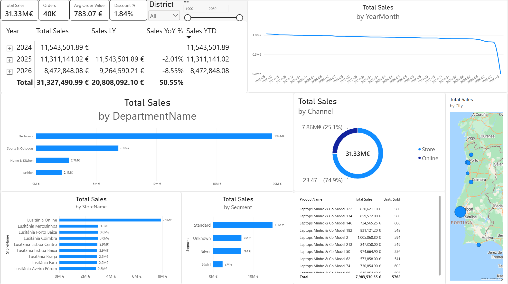
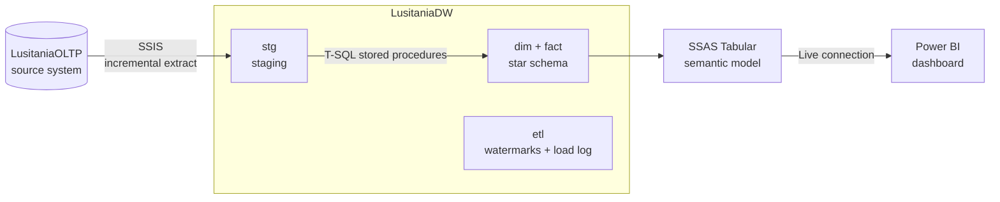
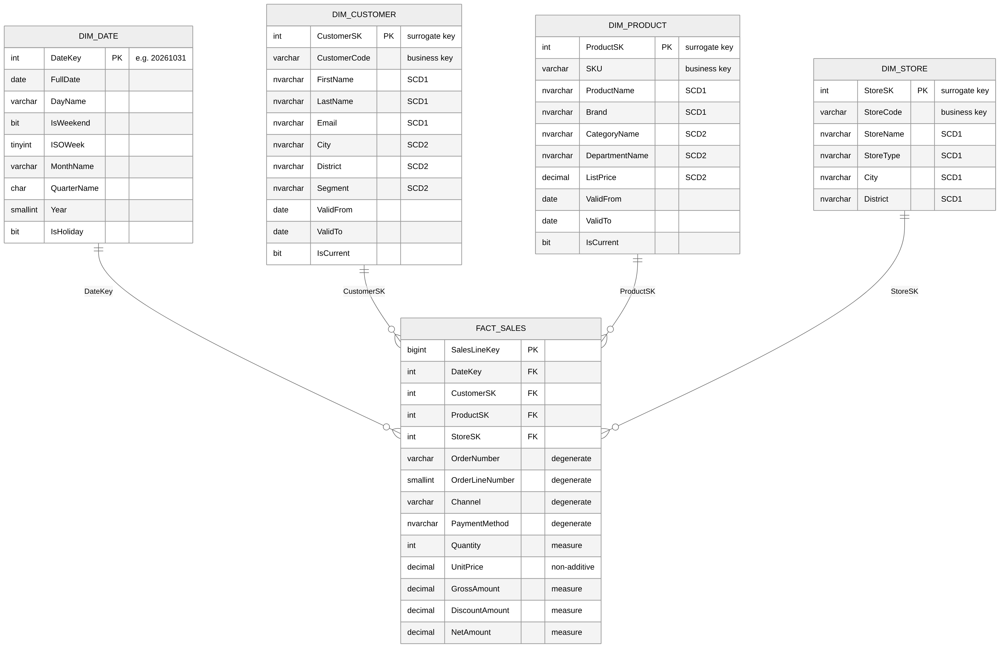

# Lusitânia Stores — Microsoft BI Data Warehouse

An end-to-end on-premises business intelligence platform for a fictional Portuguese retail chain: from an operational database to a dimensional data warehouse, a semantic model and an interactive dashboard.

<p>
  
  
  
  
  
  
  
</p>



---

## Architecture



| Layer | What it does |
|---|---|
| **Source (OLTP)** | Normalized retail database: 9 stores, 240 products, 3,000 customers, ~100,000 order lines (2024–2026) |
| **Staging (`stg`)** | Raw copy of new/changed source rows, truncated and reloaded each run |
| **Warehouse (`dim`, `fact`)** | Kimball star schema, SCD Type 1 and Type 2 dimensions, fact table at order-line grain |
| **Control (`etl`)** | Watermark per source table for incremental loads, and a log row for every load step |
| **Semantic model (SSAS)** | Relationships, DAX measures, time intelligence, date hierarchy |
| **Dashboard (Power BI)** | Live connection to the model: KPIs, trends, year-over-year, breakdowns, store map |

---

## Data model



- **fact.Sales** — grain: one row per order line. Measures: Quantity, Gross, Discount, Net amount. Degenerate dimensions: OrderNumber, Channel, PaymentMethod.
- **dim.Customer** — mixed SCD: Type 2 on City, District, Segment; Type 1 on name, email, phone.
- **dim.Product** — mixed SCD: Type 2 on Category, Department, ListPrice; Type 1 on name, brand, active flag.
- **dim.Store** — SCD Type 1.
- **dim.Date** — generated calendar 2020–2030 with ISO week, quarters and Portuguese public holidays.

Every dimension has an **Unknown member (key -1)**, so no fact row is ever lost (e.g. anonymous walk-in sales, ~22% of lines).

---

## Semantic model (SSAS Tabular)


The model hides all technical columns (surrogate keys, hashes, audit columns), marks `Date` as the date table, sorts month and day names by number, and adds a `Calendar` hierarchy (Year → Quarter → Month → Date).

| Measure | DAX idea |
|---|---|
| Total Sales, Gross Sales, Total Discount, Units Sold | `SUM` of the fact columns |
| Orders | `DISTINCTCOUNT` of OrderNumber |
| Avg Order Value, Discount % | `DIVIDE` of other measures |
| Sales LY | `SAMEPERIODLASTYEAR`, limited to dates that have data (see design decisions) |
| Sales YoY % | Change vs last year, blank when there is no comparison |
| Sales YTD | `TOTALYTD` |

---

## ETL pipeline (SSIS)

`master.dtsx` runs the whole pipeline with one click:

1. **Extract_Package.dtsx** — reads the watermarks, truncates staging, extracts only rows with `ModifiedDate > watermark` from the source.
2. **Load_warehouse.dtsx** — loads the three dimensions **in parallel**, then the fact table only after all three succeed.
3. **Update watermarks** — moves each bookmark forward, only after a successful load.

All transformation logic lives in T-SQL stored procedures; SSIS orchestrates.

---

## Design decisions

**SCD Type 2 vs Type 1, decided per column.**
History is kept only where reports need it. A customer moving city must not move their past sales to the new city, so City is Type 2. Nobody reports "sales by old email address", so Email is Type 1, which also avoids keeping personal data that has no analytical use.

**Change detection with two hashes.**
Each SCD dimension stores a SHA-256 hash of its Type 1 columns and another of its Type 2 columns. Comparing hashes tells the load *what kind* of change happened without comparing every column.

**Point-in-time lookup for the fact.**
Fact rows are matched to the dimension version valid on the sale date (`OrderDate BETWEEN ValidFrom AND ValidTo`). The first version of each member starts at 1900-01-01, so every historical sale finds a match.

**Idempotent loads.**
Every step can be rerun safely: staging is truncated, dimensions are loaded with MERGE on the business key, and the fact with MERGE on its grain (OrderNumber + OrderLineNumber), backed by a unique constraint.

**Incremental extraction with safe failure recovery.**
Watermarks are advanced only after the warehouse load succeeds. If a run fails, the next run re-extracts the same rows, which is harmless because the loads are idempotent.
*Known limitation:* watermark loads do not detect hard deletes in the source. Options would be soft-delete flags, SQL Server CDC, or a periodic business-key comparison.

**Logging.**
Every load procedure writes start time, end time, rows inserted/updated and status to `etl.LoadLog`, and records the error message on failure (TRY/CATCH, transaction rollback, re-throw so SSIS also fails).

**Fair year-over-year comparison.**
The current year is incomplete, so a naive `SAMEPERIODLASTYEAR` compares ten months against twelve. The `Sales LY` measure limits last year to the same date range as the data available this year, and returns blank for periods with no sales.

**Reconciliation.**
After each load, the warehouse is checked against the source: row count and net revenue must match exactly.

---

## Testing

| Test | Expected | Result |
|---|---|---|
| Source vs warehouse reconciliation | Same line count and net revenue | ✅ 99,875 lines · €31,326,152.90 |
| Rerun pipeline with no changes | No rows inserted or updated | ✅ |
| Customer moves city | New SCD2 version; old sales keep old city | ✅ |
| Customer changes email | Overwritten, no new version | ✅ |
| Product price change | New SCD2 version | ✅ |
| Incremental run after 1 change | Only the changed rows extracted | ✅ 1 customer, 1 sales line |

---

## Repository structure

```
sql/                       T-SQL scripts, run in order (01 → 11)
LusitaniaETL/              SSIS project (Extract_Package, Load_warehouse, master)
LusitaniaModel/            SSAS Tabular project (Model.bim)
LusitaniaPBI_report.pbix   Power BI report (live connection to SSAS)
LusitaniaBI.slnx           Visual Studio solution
*.png                      Screenshots and diagrams
```

## How to run

**Requirements:** SQL Server 2025 Developer Edition (Database Engine, Integration Services, Analysis Services in Tabular mode), SSMS, Visual Studio with the SSIS and Analysis Services extensions, Power BI Desktop.

1. Run `sql/01_create_lusitania_oltp.sql` and `sql/02_create_lusitania_dw.sql` in SSMS.
2. Run scripts `04` to `07` and `10` to create the load procedures.
3. Grant the SSAS service account read access to the warehouse:
   ```sql
   CREATE LOGIN [NT Service\MSSQLServerOLAPService] FROM WINDOWS;
   USE LusitaniaDW;
   CREATE USER [NT Service\MSSQLServerOLAPService] FOR LOGIN [NT Service\MSSQLServerOLAPService];
   ALTER ROLE db_datareader ADD MEMBER [NT Service\MSSQLServerOLAPService];
   ```
4. Open `LusitaniaBI.slnx` in Visual Studio and run `master.dtsx`.
5. Deploy `LusitaniaModel` to `localhost`.
6. Open `LusitaniaPBI_report.pbix` in Power BI Desktop.

To simulate business changes and watch them flow through the pipeline, run `sql/08_simulate_changes.sql`, run `master.dtsx` again, then `sql/09_verify_changes.sql`.

---

*All data is synthetic, generated by the scripts in this repository.*
